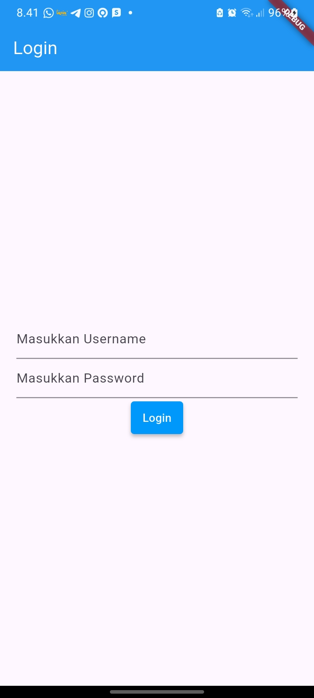
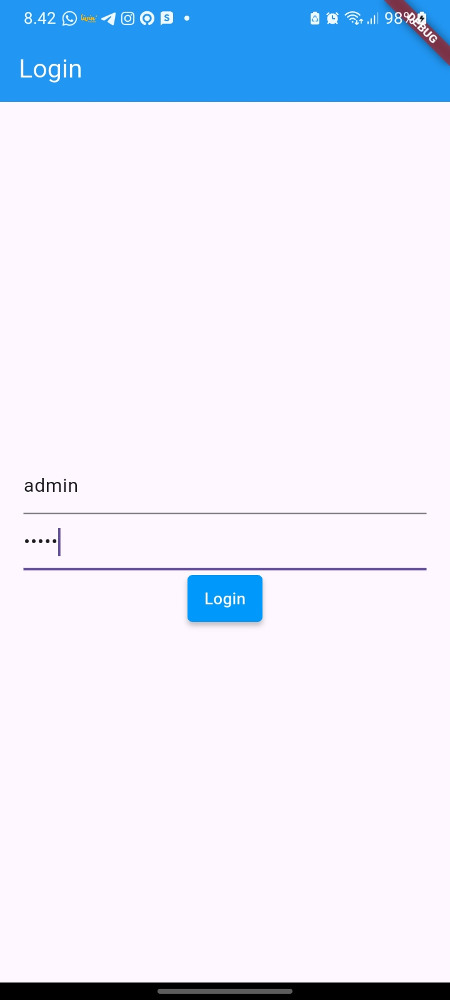
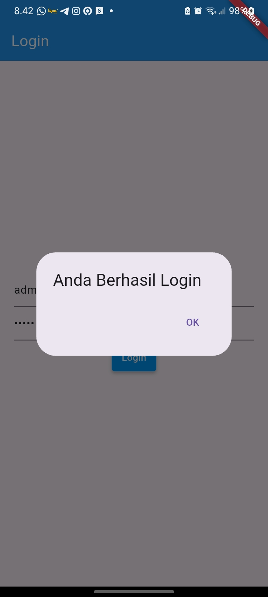
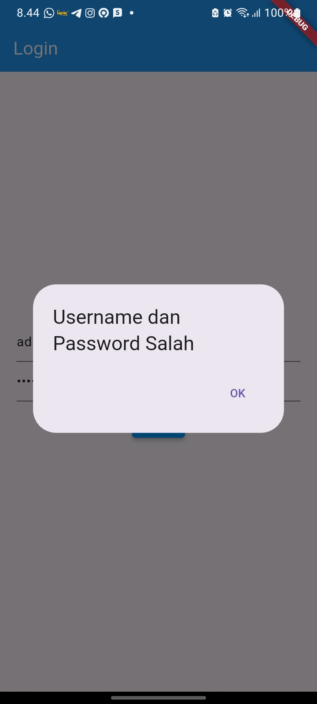
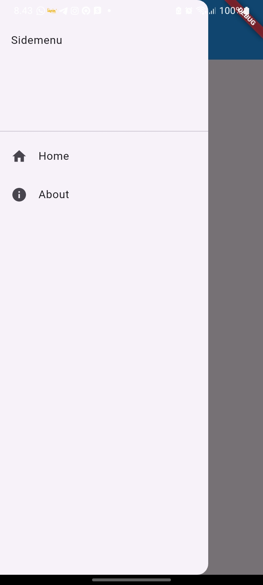

# Aplikasi Flutter: Routes, Side Menu, Login, dan Local Storage

## Identitas

**Nama** : Astria Dina Fitri  

**NIM** : H1D024004  

**Shift KRS** : B  

**Shift Baru** : F  

## Deskripsi Program

Aplikasi ini dibuat menggunakan framework Flutter untuk memenuhi tugas praktikum Pemrograman Mobile. Program ini mengimplementasikan fitur login sederhana, penyimpanan data lokal (*local storage*), navigasi antarhalaman (*routes*), dan menu samping (*side menu*).

Fitur utama aplikasi meliputi:

1. **Login:** Pengguna dapat masuk menggunakan username dan password yang telah ditentukan.

2. **Notifikasi Login:** Aplikasi menampilkan notifikasi ketika login berhasil maupun gagal.

3. **Local Storage:** Menggunakan package `shared_preferences` untuk menyimpan username pengguna pada penyimpanan lokal perangkat.

4. **Home Page:** Menampilkan halaman utama beserta username yang telah disimpan.

5. **Side Menu:** Menyediakan menu navigasi menuju halaman Home dan About.

6. **About Page:** Menampilkan halaman informasi sederhana yang dapat diakses melalui side menu.

## Logika Program

Komponen aplikasi di dalam folder `lib` dibagi berdasarkan fungsinya masing-masing:

### 1. Komponen Utama

- **`main.dart`**: Titik masuk utama (*entry point*) aplikasi Flutter yang mengatur halaman awal aplikasi melalui `MaterialApp`, yaitu `LoginPage`.

- **`login_page.dart`**: Halaman login yang menyediakan input username dan password. Aplikasi memeriksa kecocokan kedua input dengan kredensial yang telah ditentukan, kemudian menampilkan notifikasi sesuai hasil validasi.

- **`home_page.dart`**: Halaman utama yang menampilkan username pengguna yang tersimpan menggunakan `SharedPreferences`.

- **`about_page.dart`**: Halaman yang menampilkan informasi About dan menggunakan side menu untuk navigasi.

### 2. Komponen Navigasi dan Penyimpanan Data

- **`sidemenu.dart`**: Mengimplementasikan menu samping menggunakan widget `Drawer`, `ListView`, dan `ListTile`. Menu menyediakan navigasi menuju Home Page dan About Page menggunakan `Navigator.push()` serta `MaterialPageRoute`.

- **`SharedPreferences`**: Digunakan untuk menyimpan username ke penyimpanan lokal perangkat agar dapat diambil kembali pada halaman Home.

## Kredensial Login

Untuk mencoba fitur login, gunakan akun berikut:

| Username | Password |

|---|---|

| admin | admin |

## Screenshot

### 1. Login Page

### 2. Input Username dan Password

### 3. Notifikasi Login Berhasil

### 4. Notifikasi Login Gagal

### 5. Home Page

### 6. Side Menu

### 7. About Page

