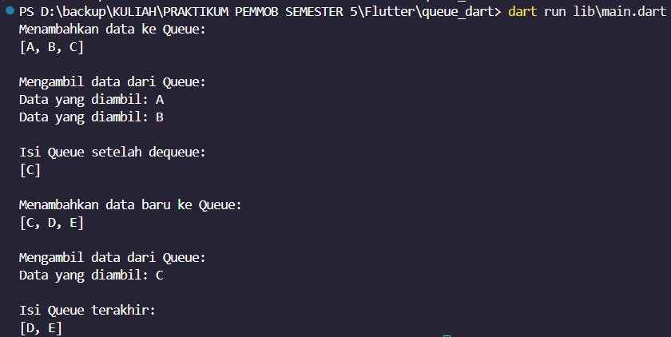

# Implementasi Queue Menggunakan Dart

## Identitas

**Nama          :** Astria Dina Fitri  
**NIM           :** H1D024004
**Shift KRS     :** B
**Shift Baru    :** F

## Deskripsi Program

Program ini adalah implementasi struktur data Queue menggunakan bahasa pemrograman Dart. Program membuat class `Queue` dengan method `enqueue()` untuk menambahkan data dan `dequeue()` untuk mengambil data dari bagian depan Queue.

## Logika Program

Program menggunakan konsep FIFO (First In, First Out), yaitu data yang pertama masuk akan menjadi data yang pertama keluar.

- `enqueue()` menambahkan data ke bagian belakang Queue.
- `dequeue()` mengambil dan menghapus data dari bagian depan Queue.
- Data Queue disimpan menggunakan `List`.

Program dijalankan melalui `main.dart` dengan membuat objek dari class `Queue`, kemudian melakukan proses `enqueue()` dan `dequeue` tanpa memerlukan input dari pengguna.

## Struktur Folder

```text
lib/
├── main.dart
└── queue.dart
```

## Screenshot 



