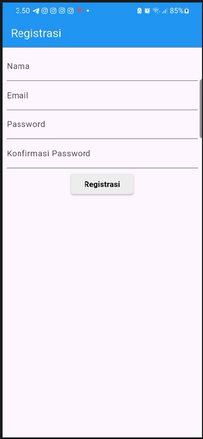
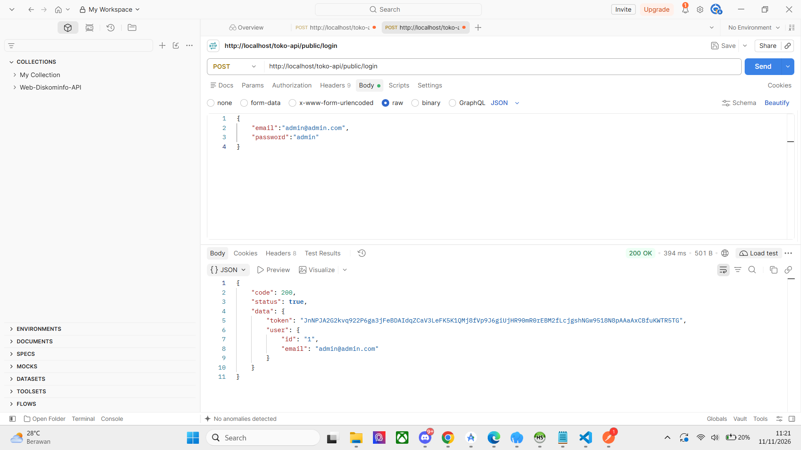
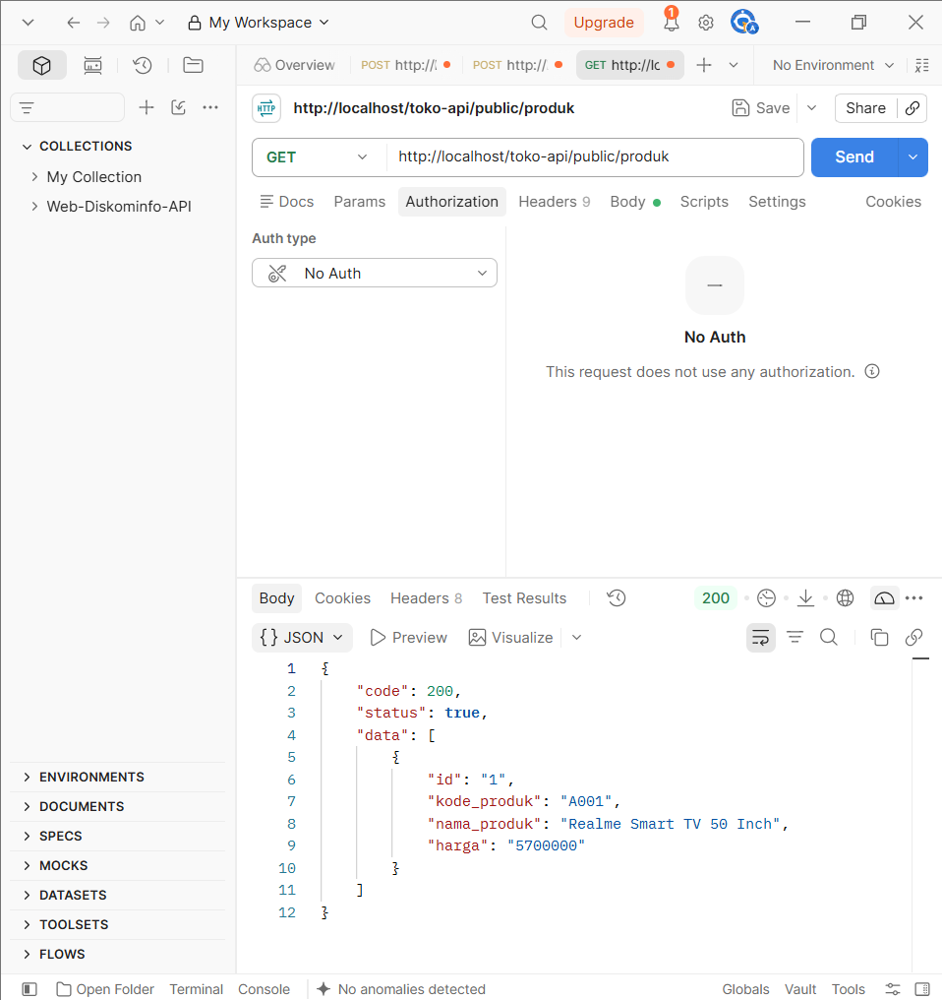
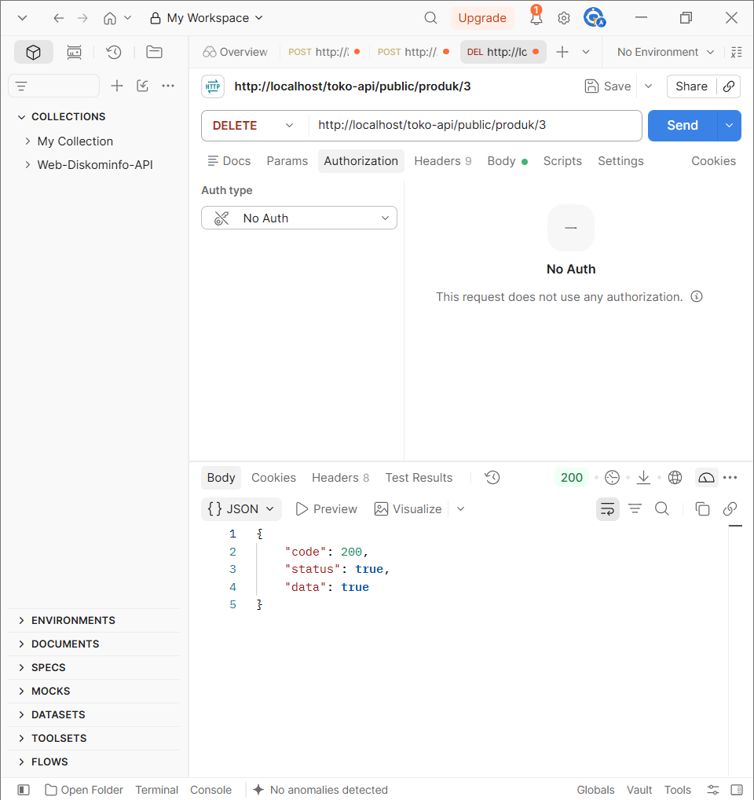

# Aplikasi Flutter: Toko Kita (Part 1: Operasi CRUD & Autentikasi)

## Identitas
**Nama** : Astria Dina Fitri  
**NIM** : H1D024004  
**Shift KRS** : B  
**Shift Baru** : F

## Deskripsi Program
Aplikasi ini dibuat menggunakan framework Flutter untuk memenuhi tugas praktikum Pemrograman Mobile. Program ini mengimplementasikan fitur autentikasi (Login & Registrasi) serta pengelolaan data produk (CRUD) yang terhubung dengan REST API (CodeIgniter 4).

Fitur utama aplikasi meliputi:
1. **Login & Registrasi:** Pengguna dapat mendaftar akun baru dan masuk ke dalam aplikasi.
2. **List Produk:** Menampilkan daftar produk yang tersedia.
3. **Tambah Produk:** Menambahkan data produk baru ke dalam sistem.
4. **Detail Produk:** Melihat informasi detail dari suatu produk.
5. **Edit Produk:** Mengubah data produk yang sudah ada.
6. **Hapus Produk:** Menghapus data produk dengan dialog konfirmasi.
7. **Side Menu:** Menyediakan navigasi tambahan (seperti Logout) menggunakan widget Drawer.

## Logika Program
Komponen aplikasi di dalam folder `lib` dibagi berdasarkan fungsinya masing-masing:

### 1. Komponen Model
- **`model/login.dart`, `registrasi.dart`, `produk.dart`**: Berisi struktur class untuk menampung data dan fungsi `fromJson` untuk mengubah data dari API menjadi objek Dart.

### 2. Komponen UI (Tampilan)
- **`main.dart`**: Titik masuk utama (*entry point*) aplikasi Flutter.
- **`ui/login_page.dart`**: Halaman login dengan input email dan password.
- **`ui/registrasi_page.dart`**: Halaman pendaftaran akun baru.
- **`ui/produk_page.dart`**: Halaman utama yang menampilkan daftar produk (List Produk).
- **`ui/produk_form.dart`**: Form untuk menambah dan mengubah data produk.
- **`ui/produk_detail.dart`**: Halaman yang menampilkan informasi spesifik dari satu produk serta tombol Edit dan Delete.

## Kredensial Login
Untuk mencoba fitur login, pastikan backend (API) sudah berjalan dan gunakan akun berikut:
| Username/Email | Password |
|---|---|
| admin@admin.com | admin |

---

## Video Demonstrasi Aplikasi

  

 

## Dokumentasi Tampilan Aplikasi
*(Geser gambar ke kiri/kanan untuk melihat semua halaman)*

  

     
    <b>Halaman Registrasi</b>
  

  

     
    <b>Halaman Login</b>
  

  

     
    <b>List Produk</b>
  

  

     
    <b>Form Tambah Produk</b>
  

  

     
    <b>Detail Produk</b>
  

  

     
    <b>Edit Produk</b>
  

  

     
    <b>Konfirmasi Hapus</b>
  

 

## Dokumentasi Pengujian API (Postman)
*(Geser gambar ke kiri/kanan untuk melihat semua pengujian)*

  

     
    <b>Test Registrasi</b>
  

  

     
    <b>Test Login</b>
  

  

     
    <b>Test Create Produk</b>
  

  

     
    <b>Test List Produk</b>
  

  

     
    <b>Test Show Produk</b>
  

  

     
    <b>Test Update Produk</b>
  

  

     
    <b>Test Delete Produk</b>
  

