# Aplikasi Flutter: Toko Kita (Part 1: Operasi CRUD & Autentikasi) dan Part 2 (Lanjutan)

## Identitas
**Nama** : Astria Dina Fitri  
**NIM** : H1D024004  
**Shift KRS** : B  
**Shift Baru** : F

## Deskripsi Program
Aplikasi ini dibuat menggunakan framework Flutter untuk memenuhi tugas praktikum Pemrograman Mobile. Program ini mengimplementasikan fitur autentikasi (Login & Registrasi) serta pengelolaan data produk (CRUD) yang terhubung dengan REST API (CodeIgniter 4).

Fitur utama aplikasi meliputi:
1. **Login & Registrasi:** Pengguna dapat mendaftar akun baru dan masuk ke dalam aplikasi.
2. **List Produk:** Menampilkan daftar produk yang tersedia.
3. **Tambah Produk:** Menambahkan data produk baru ke dalam sistem.
4. **Detail Produk:** Melihat informasi detail dari suatu produk.
5. **Edit Produk:** Mengubah data produk yang sudah ada.
6. **Hapus Produk:** Menghapus data produk dengan dialog konfirmasi.
7. **Side Menu:** Menyediakan navigasi tambahan (seperti Logout) menggunakan widget Drawer.

## Logika Program
Komponen aplikasi di dalam folder `lib` dibagi berdasarkan fungsinya masing-masing:

### 1. Komponen Model
- **`model/login.dart`, `registrasi.dart`, `produk.dart`**: Berisi struktur class untuk menampung data dan fungsi `fromJson` untuk mengubah data dari API menjadi objek Dart.

### 2. Komponen UI (Tampilan)
- **`main.dart`**: Titik masuk utama (*entry point*) aplikasi Flutter.
- **`ui/login_page.dart`**: Halaman login dengan input email dan password.
- **`ui/registrasi_page.dart`**: Halaman pendaftaran akun baru.
- **`ui/produk_page.dart`**: Halaman utama yang menampilkan daftar produk (List Produk).
- **`ui/produk_form.dart`**: Form untuk menambah dan mengubah data produk.
- **`ui/produk_detail.dart`**: Halaman yang menampilkan informasi spesifik dari satu produk serta tombol Edit dan Delete.

### 3. Komponen Helper & Bloc (Modul 5 Bagian 2)
- **`helpers/user_info.dart`**: Mengelola penyimpanan lokal (*local storage*) menggunakan `shared_preferences` untuk menyimpan dan mengambil Token (auth_key) serta User ID setelah login berhasil.
- **`helpers/app_exception.dart`**: Berisi class *custom exception* untuk menangani berbagai macam error HTTP (seperti `FetchDataException`, `BadRequestException`, dll) agar aplikasi tidak *crash* saat API gagal merespons.
- **`helpers/api.dart`**: Berisi fungsi *request* HTTP (`post`, `get`, `delete`) ke REST API. Fungsi ini secara otomatis menyisipkan Token (Bearer Token) ke dalam *header* setiap kali melakukan permintaan.
- **`helpers/api_url.dart`**: Menyimpan semua *endpoint* URL API (base URL, registrasi, login, produk) agar mudah diubah jika alamat server berpindah.
- **`bloc/registrasi_bloc.dart` & `login_bloc.dart`**: Menghubungkan halaman UI dengan API autentikasi. `LoginBloc` bertugas mengirim data email/password dan mengembalikan Token, sedangkan `RegistrasiBloc` mengirim data pendaftaran user baru.
- **`bloc/logout_bloc.dart`**: Bertugas menghapus data Token dan User ID dari *local storage* (`shared_preferences`) saat pengguna menekan tombol Logout.
- **`bloc/produk_bloc.dart`**: Menghubungkan halaman UI produk dengan API. Berisi fungsi `getProduks()` untuk mengambil daftar produk, `addProduk()` untuk menyimpan, `updateProduk()` untuk mengubah, dan `deleteProduk()` untuk menghapus data.
- **`widget/success_dialog.dart` & `warning_dialog.dart`**: Widget *pop-up* (dialog) kustom yang digunakan untuk menampilkan notifikasi berhasil (warna hijau) atau gagal (warna merah) saat proses CRUD dan autentikasi berlangsung.

## Kredensial Login
Untuk mencoba fitur login, pastikan backend (API) sudah berjalan dan gunakan akun berikut:
| Username/Email | Password |
|---|---|
| admin@admin.com | admin |

---

## Video Demonstrasi Aplikasi

  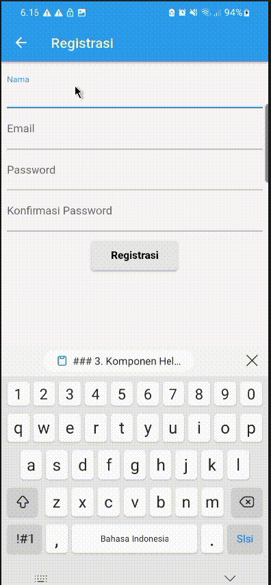
  <b>Hasil Modul 5 Bagian 2 </b>

  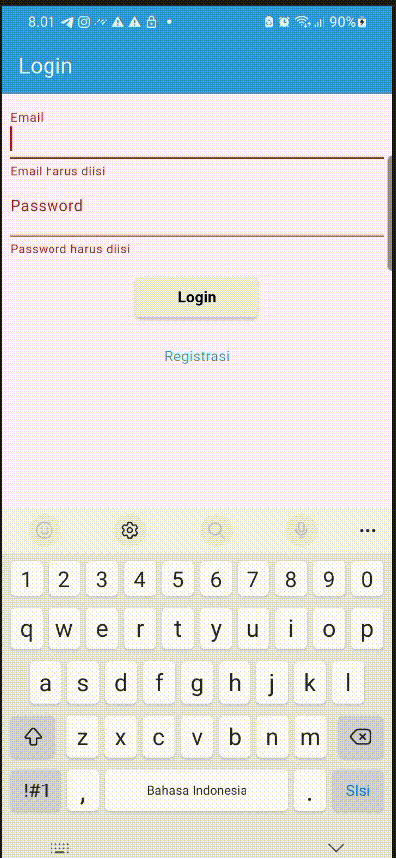
  <b>Hasil Modul 4 Bagian 1</b>

 

## Dokumentasi Perubahan Tampilan (Modul 5 Bagian 2)
Pada bagian ini, aplikasi mulai menggunakan data dari database (REST API) menggantikan data *hardcode* (dummy) yang sebelumnya ada di Modul 4. Tampilan di bawah membuktikan bahwa data produk (Realme Smart TV) berhasil ditarik dari MySQL.

  

    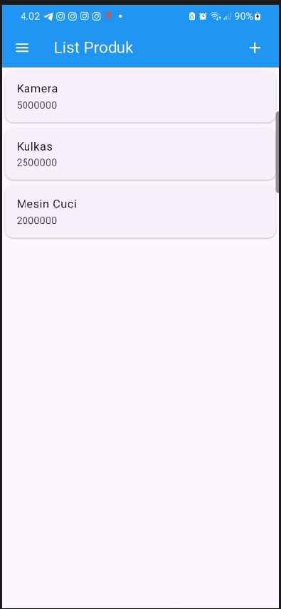 
    <b>Sebelum Modifikasi (Data Dummy)</b>
  

  

    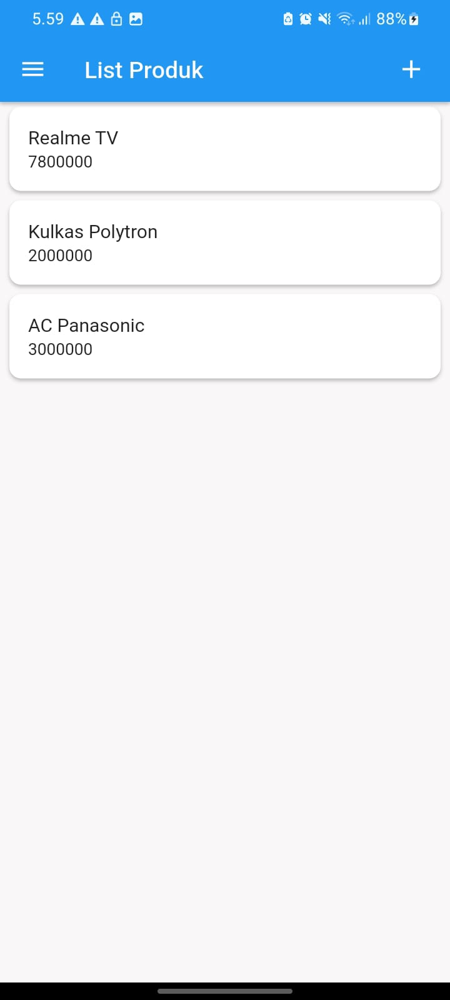 
    <b>Sesudah Modifikasi (Data dari API)</b>
  

  

    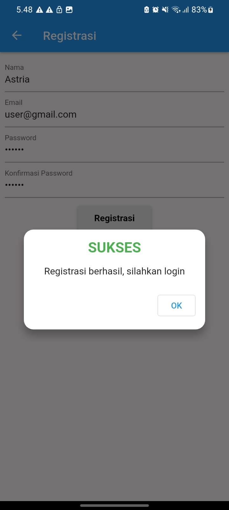 
    <b>Notifikasi Registrasi Berhasil</b>
  

  

    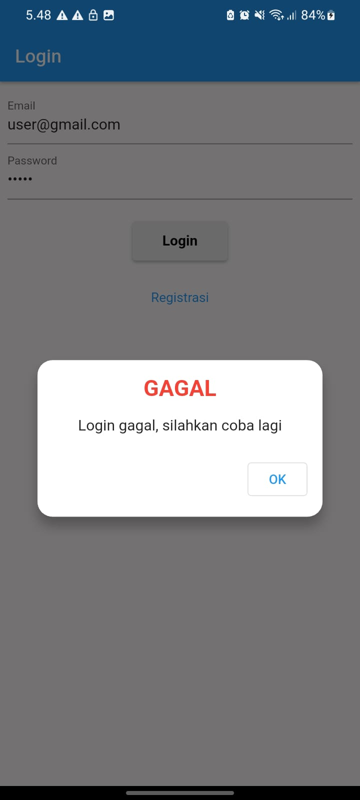 
    <b>Notifikasi Login Gagal (Error Handling)</b>
  

  

    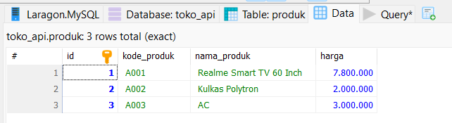 
    <b>Database MySQL (Data Produk)</b>
  

## Dokumentasi Tampilan Aplikasi (Modul 4 Bagian 1)

  

     
    <b>Halaman Registrasi</b>
  

  

    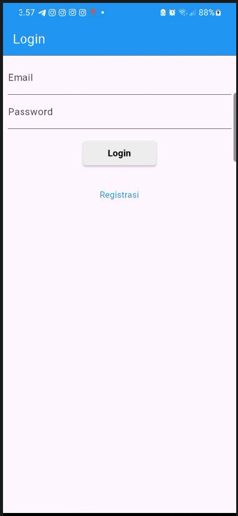 
    <b>Halaman Login</b>
  

  

     
    <b>List Produk</b>
  

  

    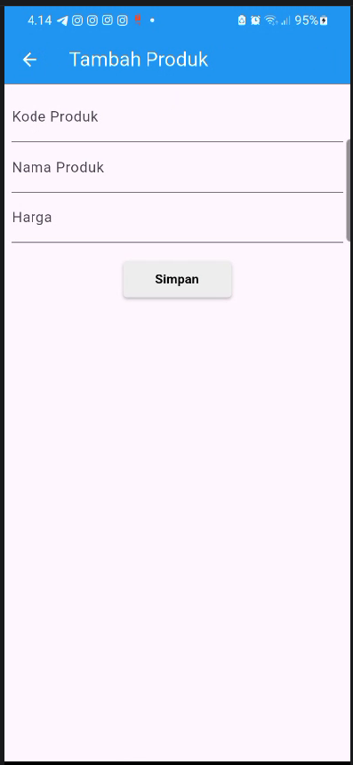 
    <b>Form Tambah Produk</b>
  

  

    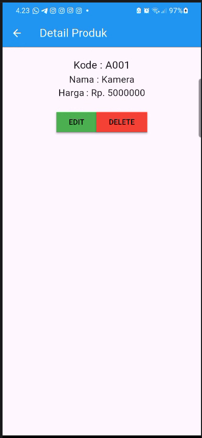 
    <b>Detail Produk</b>
  

  

    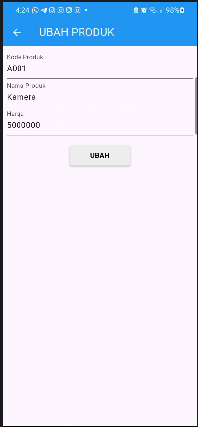 
    <b>Edit Produk</b>
  

  

    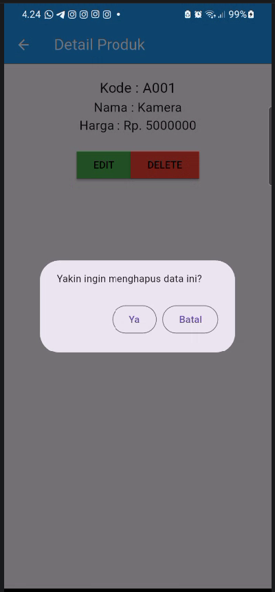 
    <b>Konfirmasi Hapus</b>
  

 

## Dokumentasi Pengujian API (Postman)

  

    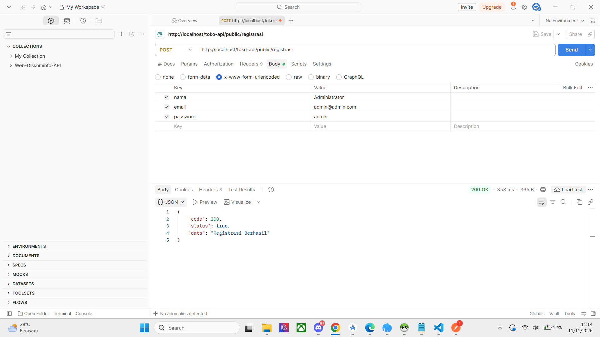 
    <b>Test Registrasi</b>
  

  

     
    <b>Test Login</b>
  

  

    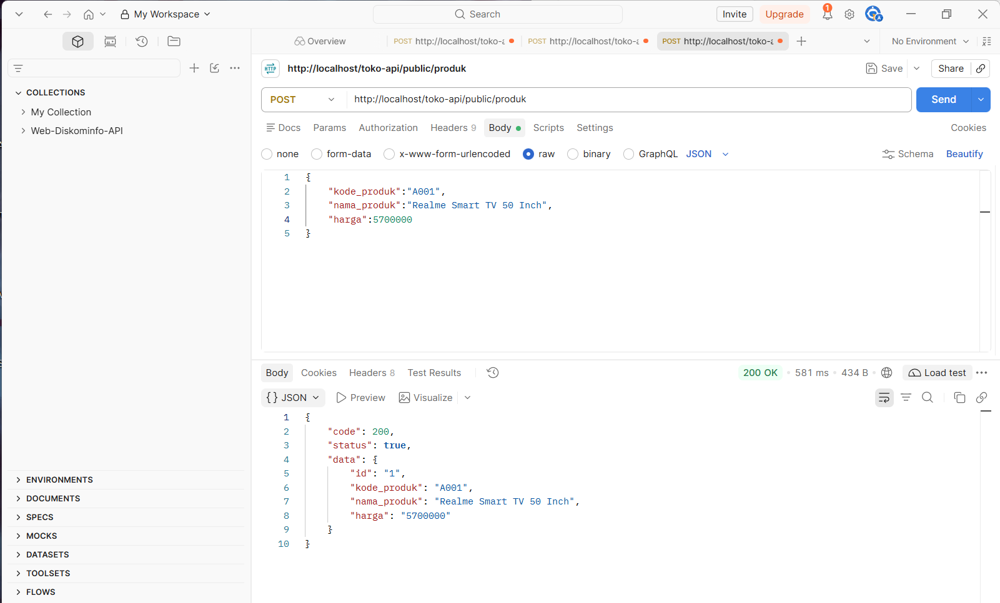 
    <b>Test Create Produk</b>
  

  

     
    <b>Test List Produk</b>
  

  

    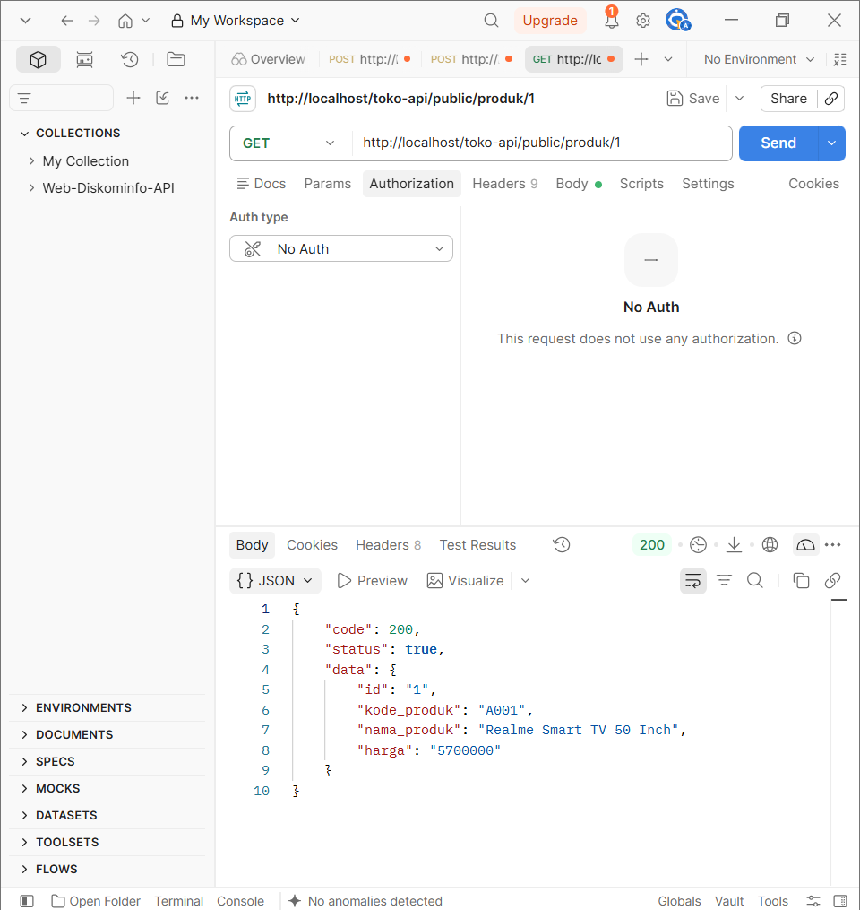 
    <b>Test Show Produk</b>
  

  

    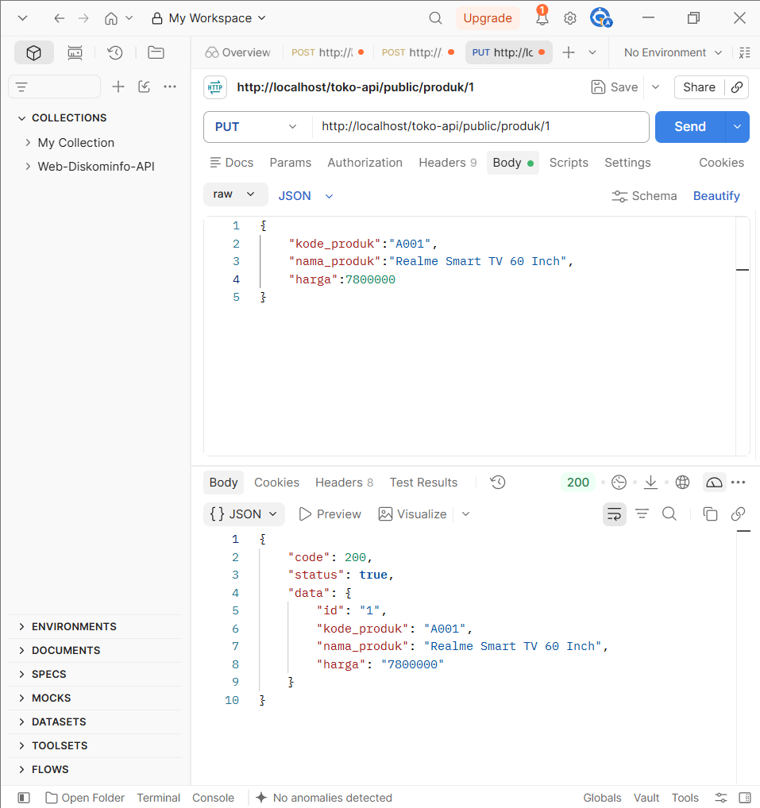 
    <b>Test Update Produk</b>
  

  

     
    <b>Test Delete Produk</b>
  

